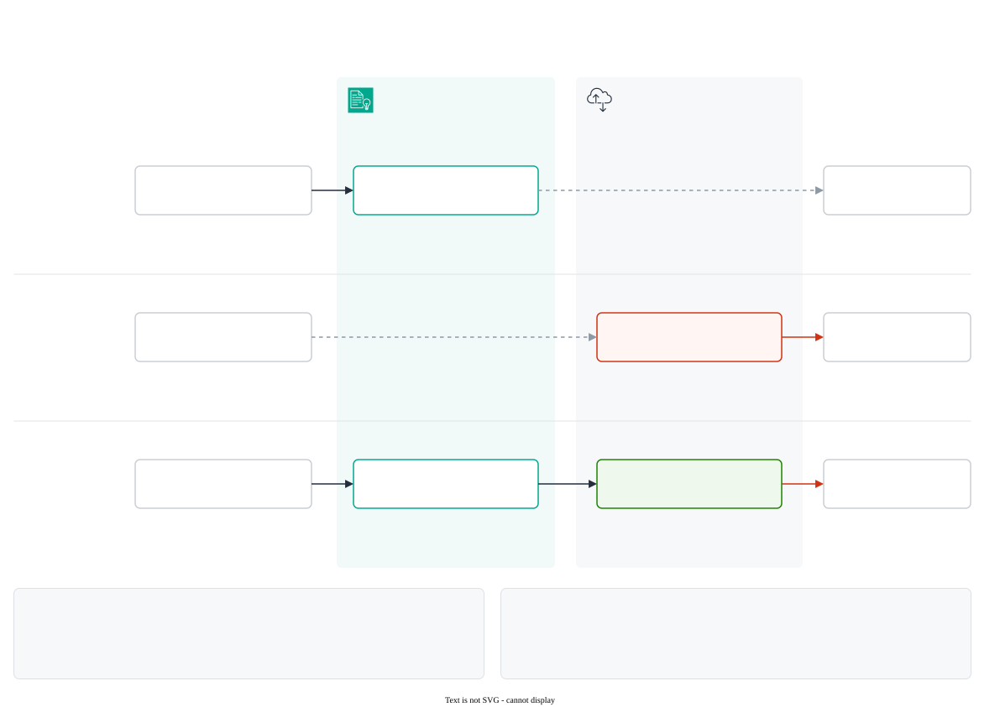
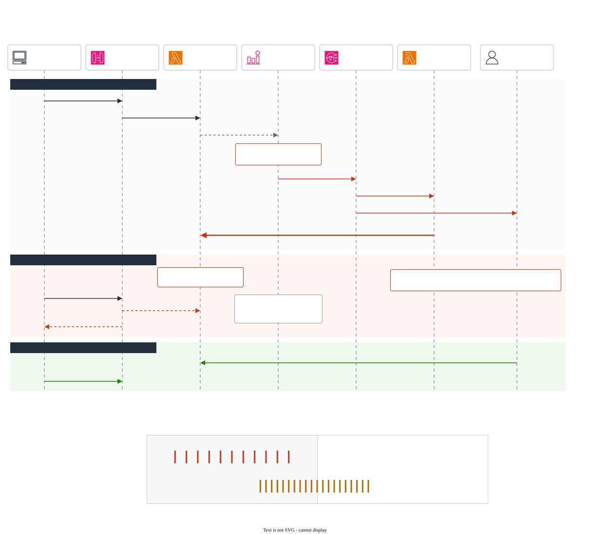

# Guardrail AI Moderator

A serverless API on AWS that receives an **English** text and censors parts of it with `***`: personal data (PII), inappropriate content, or both. Personal data is detected by Amazon Comprehend and inappropriate content by the OpenAI Moderation API.

The infrastructure is defined in Terraform and deployed only by GitHub Actions. The stack is created for a demo and destroyed afterwards, so it costs nothing while it is down.

> [!NOTE]
> **The API is only online during demos.** This repository is the definition of the infrastructure, not a service that is always running. Outside a demo, the URL does not exist and every request fails.

## Demo access

A demo works like this:

1. The `apply` workflow creates the stack, and the alert e-mail subscription is confirmed.
2. The API key is copied from the AWS Console (API Gateway → API Keys → Show) and handed directly to the person trying the API. It is never published in this repository.
3. The URL is the stage's Invoke URL (API Gateway → Stages → `v1`) followed by `/moderar`.
4. After the demo, the `destroy` workflow removes everything. The next `apply` creates a new URL and a new key.

The protections stay on during a demo. **More than 10 requests in the same clock minute trigger the kill switch**, and the API stays down until the next `apply`.

## API

### Request

`POST <URL>`, where `<URL>` looks like `https://<api-id>.execute-api.us-east-1.amazonaws.com/v1/moderar`.

| Header | Value |
|---|---|
| `x-api-key` | the API key handed over for the demo |
| `Content-Type` | `application/json` |

```json
{
  "texto": "My name is John Smith and my email is john.smith@example.com.",
  "modo": 1
}
```

- `texto`: required string, 1 to 1,000 characters (Unicode code points). A text made only of spaces is accepted and returned unchanged.
- `modo`: required integer. `"1"`, `1.0` and `true` are rejected.
  - `1`: censor personal data only
  - `2`: censor inappropriate content only
  - `3`: censor both, personal data first

Only English is supported. A text in another language does not cause an error, but its personal data is not reliably detected and may come back uncensored (see [Limitations and risks](#limitations-and-risks)).

### Response

```json
{
  "texto_censurado": "My name is *** and my email is ***."
}
```

Personal data is replaced span by span, keeping the rest of the text. If OpenAI flags the text as inappropriate, the whole response becomes `"***"`, even if PII had already been replaced.

### Errors

Every error has the same body, `{"erro": "<generic message>"}`, with a message in Portuguese. The text sent is never returned in an error.

| Status | Cause | Message |
|---|---|---|
| `400` | Malformed JSON, `Content-Type` other than `application/json`, `texto` missing, empty or over 1,000 characters, `modo` missing, not an integer or not 1, 2 or 3 | `requisição inválida` |
| `403` | `x-api-key` header missing or invalid | `acesso negado` |
| `429` | Usage plan throttle (5 req/s, burst 10) or daily quota (1,000 requests) exceeded | `limite de requisições excedido` |
| `502` | Comprehend, Parameter Store or OpenAI failed or timed out. No text is returned (fail closed) | `serviço de moderação indisponível` |
| other `5xx` | Kill switch active, Lambda timeout or unexpected error | `serviço de moderação indisponível` |

### Examples

Replace `<URL>` and `<API_KEY>` with the values handed over for the demo.

**Mode 1: personal data only**

```bash
curl -X POST '<URL>' \
  -H 'x-api-key: <API_KEY>' \
  -H 'Content-Type: application/json' \
  -d '{"texto": "My name is John Smith and my email is john.smith@example.com.", "modo": 1}'
```

```json
{"texto_censurado": "My name is *** and my email is ***."}
```

**Mode 2: inappropriate content only**

```bash
curl -X POST '<URL>' \
  -H 'x-api-key: <API_KEY>' \
  -H 'Content-Type: application/json' \
  -d '{"texto": "I want to kill you.", "modo": 2}'
```

```json
{"texto_censurado": "***"}
```

Mode 2 does not redact personal data: if the text is not flagged, it comes back unchanged, names and e-mails included. It also sends the original text to OpenAI (see [Mode 2 sends the original text to OpenAI](#mode-2-sends-the-original-text-to-openai)).

**Mode 3: both**

```bash
curl -X POST '<URL>' \
  -H 'x-api-key: <API_KEY>' \
  -H 'Content-Type: application/json' \
  -d '{"texto": "My name is John Smith. I want to kill you.", "modo": 3}'
```

```json
{"texto_censurado": "***"}
```

Without the threat, the same mode returns only the personal data censored: `"My name is John Smith."` becomes `"My name is ***."`.

The examples use bash syntax (Linux, macOS, Git Bash or WSL). Windows PowerShell 5.1 strips the inner double quotes from the JSON body when it calls `curl.exe`, so run them from one of those shells.

## Architecture


**Request path** (dark numbered arrows)

1. The client sends `POST /v1/moderar` with the `x-api-key` header and a JSON body.
2. API Gateway checks the key, the throttle, the daily quota and the JSON schema. Only valid requests invoke the Lambda.
3. In modes 1 and 3, Comprehend detects PII and each detected span is replaced with `***`.
4. In modes 2 and 3, the OpenAI key is read from Parameter Store once per Lambda container and cached in memory.
5. In modes 2 and 3, OpenAI Moderation checks the text. If the text is flagged, the whole text becomes `***`. In mode 3, OpenAI only receives the text already redacted by Comprehend.
6. Each request writes one log line with metadata only (status, mode, length, latency), never the text. If Comprehend, Parameter Store or OpenAI fails, the Lambda answers `502` and returns no text (fail closed).

**Kill switch** (red lettered arrows)

- **A.** The moderator's invocations are summed per clock minute.
- **B.** More than 10 puts the alarm in `ALARM`, and it publishes to the SNS topic.
- **C.** SNS invokes the kill-switch Lambda and e-mails the operator.
- **D.** The kill switch sets the moderator's reserved concurrency to `0`. From then on the API answers `5xx` and processes no text.
- **E.** If the kill switch itself fails, a second alarm on its `Errors` metric sends an e-mail.

Nothing turns the API back on automatically. Only a manual run of the `apply` workflow restores it.

| Component | Resource | Role |
|---|---|---|
| API Gateway (REST, regional) | `POST /v1/moderar`, stage `v1` | API key, usage plan (5 req/s, burst 10, 1,000 req/day), JSON-schema validator, uniform `{"erro": …}` error bodies |
| AWS Lambda | `guardrails-moderador` | Python 3.13, arm64, 256 MB, 15 s timeout, no VPC, no third-party packages |
| Amazon Comprehend | `DetectPiiEntities` | Detects personal data (English only) |
| OpenAI Moderation API | `omni-moderation-latest` | Detects inappropriate content (third party, outside AWS) |
| SSM Parameter Store | `guardrails-openai-api-key` | Stores the OpenAI key as a `SecureString` (AWS-managed `aws/ssm` key) |
| CloudWatch Logs | `/aws/lambda/guardrails-*` | Metadata-only logs, 14-day retention |
| CloudWatch alarms, SNS, Lambda | `guardrails-alertas`, `guardrails-kill-switch` | Kill switch and alert e-mails |

The stack runs in `us-east-1` because Comprehend is not available in São Paulo (`sa-east-1`). The Lambda has no VPC, so it needs no NAT Gateway, which would cost about US$ 32 a month just to exist.

The API contract keeps its original Portuguese field names: `texto` and `modo` in the request, `texto_censurado` in the response and `erro` in errors.

### Request flow

Which check produces each status code, and what the Lambda does in each mode.


- Requests rejected by API Gateway (`403`, `429` and the validator's `400`) never invoke the Lambda. They cost no Comprehend call and do not count toward the kill switch.
- The validator only checks bodies sent as `application/json`. A body with another `Content-Type` reaches the Lambda, which rejects it with `400`. That request still counts as an invocation.
- In Case 1, overlapping or adjacent PII spans are merged before replacement, so the text never gets `******` or broken offsets.
- In Case 2, the Moderation API does not say *where* the problem is, so a flagged text is censored entirely.

### Where the text goes in each mode



Each mode does only its own job. Mode 1 does not moderate content, so a threat comes back uncensored. Mode 2 does not redact PII, and it sends the **original** text, personal data included, to OpenAI. Use mode 3 when the text may contain personal data.

### Kill switch



The timings are from the real test on AWS. The alarm counts invocations per clock minute, not over a sliding 60-second window, so a burst split across two minutes can pass about 20 invocations without triggering. This is accepted because those requests cost cents, and the daily quota caps slower abuse.

### Delivery: GitHub Actions and OIDC


1. Every pull request and every push to `main` runs the `test` workflow, which has no AWS credentials.
2. The `apply` and `destroy` workflows only run when started by hand, and only on `main`.
3. The workflow sends an OIDC token issued by GitHub. No AWS access key is stored anywhere.
4. AWS STS checks the role's trust policy (`main` branch of this repository only) and returns short-lived credentials for the deploy role.
5. Terraform reads and locks its state in a private, versioned S3 bucket.
6. Terraform creates, updates or destroys the `guardrails-*` resources.

The resources in the "Bootstrap" box were created once in the AWS Console and are not managed by Terraform, so `destroy` does not remove them.

### Permissions


Each Lambda role has only the actions it needs, on the exact resource ARN whenever the service supports it. `DetectPiiEntities` has no resource-level permissions, so it is the only action granted on `*`.

### Cost protection


The usage plan's throttle and quota are best effort according to AWS. In the real test, the throttle stopped only 1 of 120 parallel requests. That is why the kill switch, not the throttle, is the cost control. The worst-case figures are estimates from AWS list prices; a sustained flood was not tested.

### Editing the diagrams

The diagrams are `.drawio.svg` files: each SVG has its editable draw.io diagram embedded. Open them in [draw.io Desktop](https://github.com/jgraph/drawio-desktop) or in VS Code with the [Draw.io Integration](https://marketplace.visualstudio.com/items?itemName=hediet.vscode-drawio) extension, then save; the image updates on save.

## Limitations and risks

This is a portfolio project. The limitations below are known and accepted on purpose, and they are listed here so that nobody has to find them out on their own.

> [!IMPORTANT]
> Use fictitious data in demos. Do not send real personal data of anyone to this API: the text leaves Brazil, goes to third-party services and is not guaranteed to be anonymized.

### English only

Comprehend's `DetectPiiEntities` supports only English and Spanish, not Portuguese, and the Lambda always calls it with `LanguageCode="en"`. A text in another language is not rejected. The API answers normally, but its personal data is not reliably detected and may come back uncensored.

Only the entity types in a closed list are censored: names, e-mails, phone numbers, addresses, US Social Security numbers, card and bank data, passport and driver's license numbers, IP addresses and passwords. Identifiers from other countries, such as the Brazilian CPF, are not on the list.

### Comprehend is not an anonymization guarantee

Comprehend is a machine learning model. It can miss personal data (false negatives) and censor ordinary words (false positives), so the output must not be treated as anonymized data.

- Only entities with a confidence score of at least `0.5` are censored. The threshold is low on purpose, because in a guardrail censoring too much is better than letting personal data through, but it does not catch everything.
- Entity types outside the list, such as `DATE_TIME`, `AGE` and `URL`, are kept on purpose.
- In mode 3, whatever Comprehend misses goes to OpenAI as it is.

### Mode 2 sends the original text to OpenAI

Mode 2 has no Comprehend step. The **original text**, personal data included, is sent to OpenAI, and if it is not flagged it comes back unchanged. Use mode 3 when the text may contain personal data. Even then, mode 3 only protects what Comprehend detects.

### Region and LGPD

The stack runs in `us-east-1`, because Comprehend is not available in São Paulo (`sa-east-1`). The text therefore leaves Brazil already at the PII detection step, not only at the moderation step. Under Brazil's data protection law (LGPD), sending personal data to these services is an international data transfer.

The fixed order Comprehend → OpenAI does not keep the processing in Brazil. Its purpose is narrower: in mode 3, it keeps personal data from reaching, in clear text, a third party outside AWS. In mode 2 that protection does not exist.

This project has not gone through an LGPD compliance review. Using it with real personal data would need its own legal basis and assessment.

### Data retention by AWS and OpenAI

| Where | What is kept | Control in this project |
|---|---|---|
| This stack | No text. CloudWatch Logs keep one metadata line per request (status, mode, length, latency) for 14 days. API Gateway has no access or execution logs. | Log policy in the code and retention set in Terraform |
| Amazon Comprehend | As an AWS AI service, it may by default store and use the processed content to improve the service. | AWS Organizations AI services opt-out policy for all AI services, attached to the root with `@@none` so it cannot be overridden. It was created once in the Console, outside Terraform: a fork deployed to another account needs its own. |
| OpenAI Moderation | Under OpenAI's API data policy, abuse monitoring logs are kept for up to 30 days, unless longer retention is required by law, and API data is not used for training by default. In mode 2 this is the original text; in mode 3, the text already redacted by Comprehend. | None on this side. Zero Data Retention requires OpenAI's approval. |

These are the providers' policies at the time of writing, and they can change. Check [OpenAI's data controls](https://developers.openai.com/api/docs/guides/your-data) and the [AWS AI services opt-out policies](https://docs.aws.amazon.com/organizations/latest/userguide/orgs_manage_policies_ai-opt-out.html) before relying on them.

### Residual risk of the deploy role

The deploy role used by GitHub Actions has to create IAM roles and pass them to Lambda, because Terraform creates the Lambda roles. Those IAM actions are restricted to the `guardrails-*` prefix, and `iam:PassRole` only works for `lambda.amazonaws.com`.

The prefix restricts the **names** of the roles, not the **permissions** given to them. The deploy role can still create a `guardrails-*` role with broad permissions and attach it to a Lambda. This is a known risk, accepted instead of a permissions boundary:

- The main mitigation is the trust policy. The role only accepts OIDC tokens from the `main` branch of this repository, identified by the owner's and the repository's immutable IDs. Only code that reached `main` can assume it, and this repository has a single developer.
- The deploy role is outside the `guardrails-*` prefix and its permissions are an inline policy, so it cannot change its own permissions.
- Third-party actions are pinned by commit SHA, and pull requests from forks run only the `test` workflow, without secrets or AWS credentials.

If more people get write access to `main`, the next step is a permissions boundary that every `guardrails-*` role must carry.

### `Content-Type` bypasses the request validator

API Gateway's request validator chooses the JSON schema by the request's `Content-Type`. The real test on AWS confirmed that a body sent as `text/plain` or `application/x-www-form-urlencoded` passes API Gateway without validation and invokes the Lambda. Bodies sent as `application/json`, with any casing and with parameters such as `; charset=utf-8`, are validated normally.

The Lambda checks the header itself and answers `400` (`requisição inválida`) without calling Comprehend, Parameter Store or OpenAI, so no text is processed. The request is still a Lambda invocation: it costs a Lambda call and **counts toward the kill switch**. This deviation is accepted, because the kill switch already treats more than 10 invocations a minute as abuse, valid or not.

## Repository layout

```text
src/moderador/        main Lambda (Python, no third-party packages)
src/kill_switch/      kill-switch Lambda
tests/                unit tests (pytest)
infra/                Terraform
.github/workflows/    test, apply, destroy
docs/diagrams/        architecture diagrams (.drawio.svg)
```
