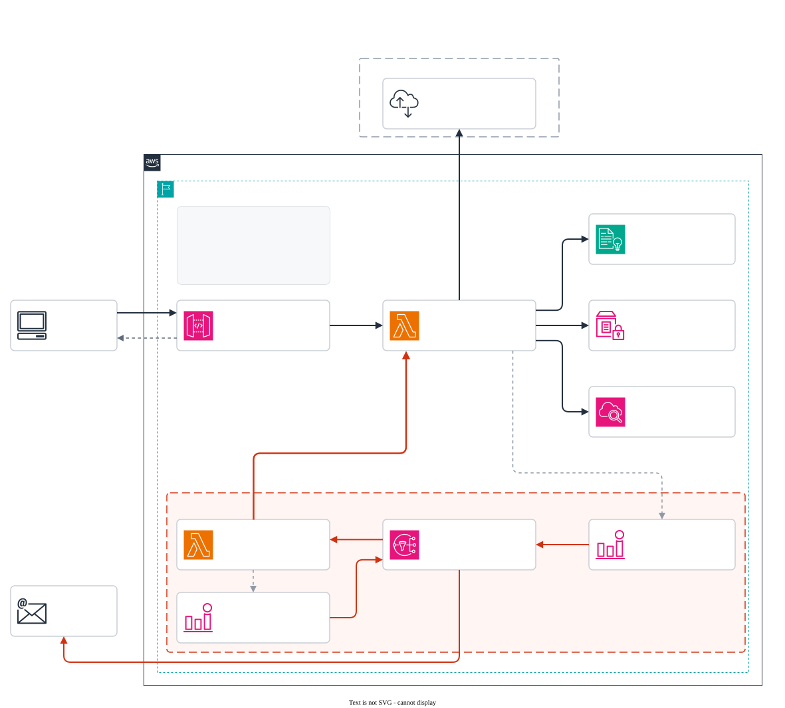
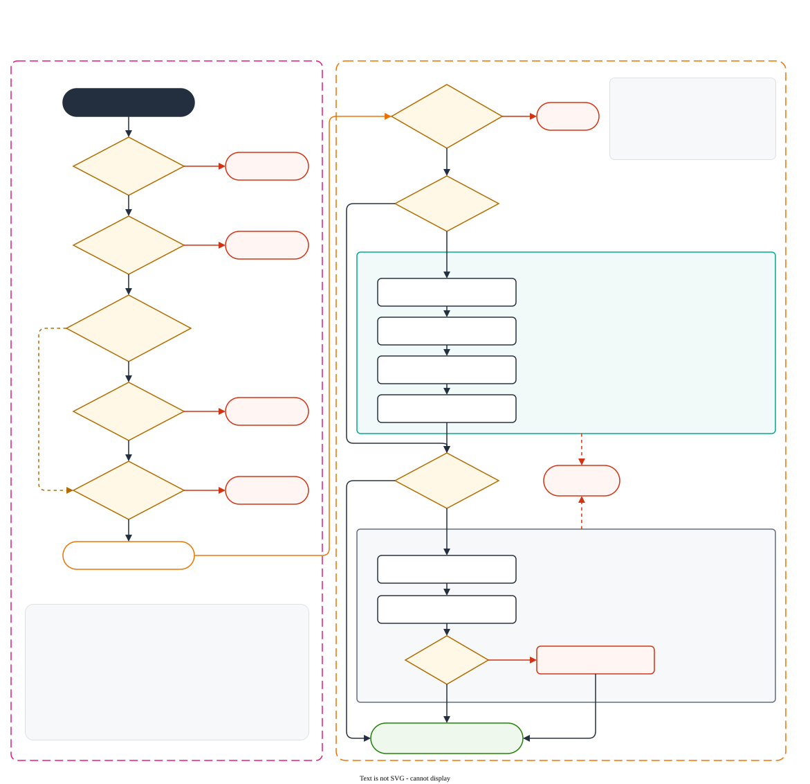
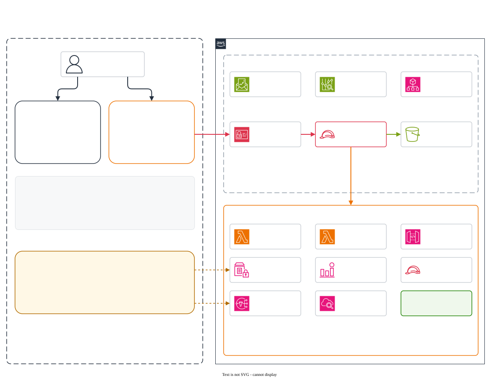
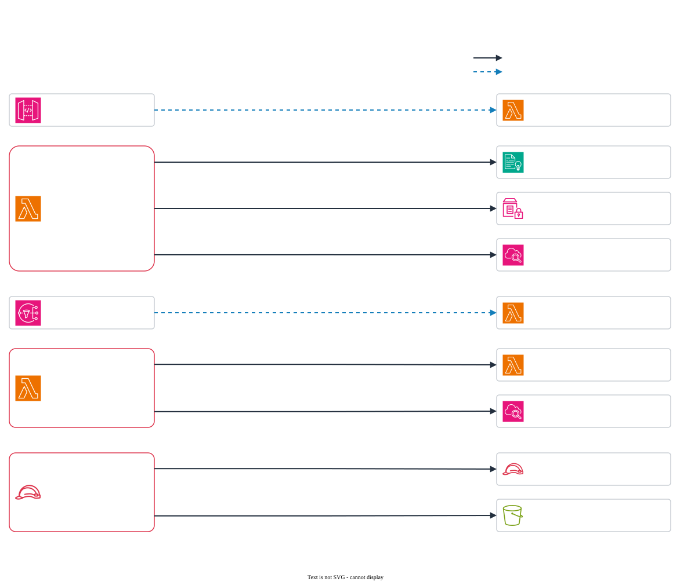
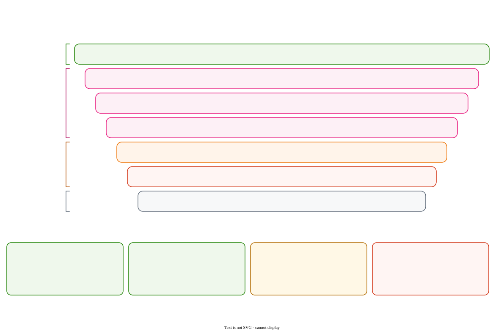

# Guardrail AI Moderator

A serverless API on AWS that receives an **English** text and censors parts of it with `***`: personal data (PII), inappropriate content, or both. Personal data is detected by Amazon Comprehend and inappropriate content by the OpenAI Moderation API.

The infrastructure is defined in Terraform and deployed only by GitHub Actions. The stack is created for a demo and destroyed afterwards, so it costs nothing while it is down.

## Architecture



**Request path** (dark numbered arrows)

1. The client sends `POST /v1/moderar` with the `x-api-key` header and a JSON body.
2. API Gateway checks the key, the throttle, the daily quota and the JSON schema. Only valid requests invoke the Lambda.
3. In modes 1 and 3, Comprehend detects PII and each detected span is replaced with `***`.
4. In modes 2 and 3, the OpenAI key is read from Parameter Store once per Lambda container and cached in memory.
5. In modes 2 and 3, OpenAI Moderation checks the text. If the text is flagged, the whole text becomes `***`. In mode 3, OpenAI only receives the text already redacted by Comprehend.
6. Each request writes one log line with metadata only (status, mode, length, latency), never the text. If Comprehend, Parameter Store or OpenAI fails, the Lambda answers `502` and returns no text (fail closed).

**Kill switch** (red lettered arrows)

- **A.** The moderator's invocations are summed per clock minute.
- **B.** More than 10 puts the alarm in `ALARM`, and it publishes to the SNS topic.
- **C.** SNS invokes the kill-switch Lambda and e-mails the operator.
- **D.** The kill switch sets the moderator's reserved concurrency to `0`. From then on the API answers `5xx` and processes no text.
- **E.** If the kill switch itself fails, a second alarm on its `Errors` metric sends an e-mail.

Nothing turns the API back on automatically. Only a manual run of the `apply` workflow restores it.

| Component | Resource | Role |
|---|---|---|
| API Gateway (REST, regional) | `POST /v1/moderar`, stage `v1` | API key, usage plan (5 req/s, burst 10, 1,000 req/day), JSON-schema validator, uniform `{"erro": …}` error bodies |
| AWS Lambda | `guardrails-moderador` | Python 3.13, arm64, 256 MB, 15 s timeout, no VPC, no third-party packages |
| Amazon Comprehend | `DetectPiiEntities` | Detects personal data (English only) |
| OpenAI Moderation API | `omni-moderation-latest` | Detects inappropriate content (third party, outside AWS) |
| SSM Parameter Store | `guardrails-openai-api-key` | Stores the OpenAI key as a `SecureString` (AWS-managed `aws/ssm` key) |
| CloudWatch Logs | `/aws/lambda/guardrails-*` | Metadata-only logs, 14-day retention |
| CloudWatch alarms, SNS, Lambda | `guardrails-alertas`, `guardrails-kill-switch` | Kill switch and alert e-mails |

The stack runs in `us-east-1` because Comprehend is not available in São Paulo (`sa-east-1`). The Lambda has no VPC, so it needs no NAT Gateway, which would cost about US$ 32 a month just to exist.

The API contract keeps its original Portuguese field names: `texto` and `modo` in the request, `texto_censurado` in the response and `erro` in errors.

### Request flow

Which check produces each status code, and what the Lambda does in each mode.



- Requests rejected by API Gateway (`403`, `429` and the validator's `400`) never invoke the Lambda. They cost no Comprehend call and do not count toward the kill switch.
- The validator only checks bodies sent as `application/json`. A body with another `Content-Type` reaches the Lambda, which rejects it with `400`. That request still counts as an invocation.
- In Case 1, overlapping or adjacent PII spans are merged before replacement, so the text never gets `******` or broken offsets.
- In Case 2, the Moderation API does not say *where* the problem is, so a flagged text is censored entirely.

### Where the text goes in each mode


Each mode does only its own job. Mode 1 does not moderate content, so a threat comes back uncensored. Mode 2 does not redact PII, and it sends the **original** text, personal data included, to OpenAI. Use mode 3 when the text may contain personal data.

### Kill switch


The timings are from the real test on AWS. The alarm counts invocations per clock minute, not over a sliding 60-second window, so a burst split across two minutes can pass about 20 invocations without triggering. This is accepted because those requests cost cents, and the daily quota caps slower abuse.

### Delivery: GitHub Actions and OIDC



1. Every pull request and every push to `main` runs the `test` workflow, which has no AWS credentials.
2. The `apply` and `destroy` workflows only run when started by hand, and only on `main`.
3. The workflow sends an OIDC token issued by GitHub. No AWS access key is stored anywhere.
4. AWS STS checks the role's trust policy (`main` branch of this repository only) and returns short-lived credentials for the deploy role.
5. Terraform reads and locks its state in a private, versioned S3 bucket.
6. Terraform creates, updates or destroys the `guardrails-*` resources.

The resources in the "Bootstrap" box were created once in the AWS Console and are not managed by Terraform, so `destroy` does not remove them.

### Permissions



Each Lambda role has only the actions it needs, on the exact resource ARN whenever the service supports it. `DetectPiiEntities` has no resource-level permissions, so it is the only action granted on `*`.

### Cost protection



The usage plan's throttle and quota are best effort according to AWS. In the real test, the throttle stopped only 1 of 120 parallel requests. That is why the kill switch, not the throttle, is the cost control. The worst-case figures are estimates from AWS list prices; a sustained flood was not tested.

### Editing the diagrams

The diagrams are `.drawio.svg` files: each SVG has its editable draw.io diagram embedded. Open them in [draw.io Desktop](https://github.com/jgraph/drawio-desktop) or in VS Code with the [Draw.io Integration](https://marketplace.visualstudio.com/items?itemName=hediet.vscode-drawio) extension, then save; the image updates on save.

## Repository layout

```text
src/moderador/        main Lambda (Python, no third-party packages)
src/kill_switch/      kill-switch Lambda
tests/                unit tests (pytest)
infra/                Terraform
.github/workflows/    test, apply, destroy
docs/diagrams/        architecture diagrams (.drawio.svg)
```
